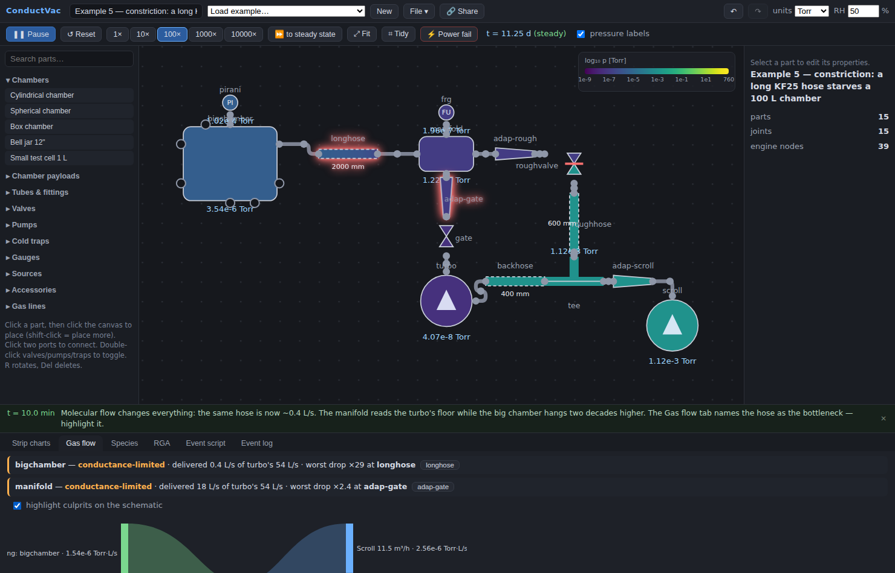

Build a vacuum system out of a parts library (chambers, tubes, fittings, valves, pumps, gauges, leaks), then watch it pump down from atmosphere to UHV. The gas dynamics are regime-aware, and everything runs client-side in the browser.

Code: [github.com/sinkomr/ConductVac](https://github.com/sinkomr/ConductVac)

## What it does

- A live pressure colormap over the schematic, spanning 12 decades, including the gradients along the plumbing.
- Gauges that lie realistically: gas-species sensitivity, response lag, noise, Pirani flatline, cold-cathode strike failures, hot-cathode filament trips, and the X-ray limit. The strip charts overlay the true pressure so you can watch your gauges deceive you.
- A gas-load flow view from sources (leaks, outgassing, permeation) through the network to the pumps, which answers "what limits my base pressure?"
- Multiple gas species, bakeout, gas ballast, helium spray on leaks, LN₂ cold traps, and chamber payloads whose surface area drives outgassing.
- Timeline scripting, plus live interaction: double-click a valve mid-rough-down to see why crossover discipline matters.
- A catalog of about 80 named commercial pumps and 17 named gauges with nominal datasheet values. Check current manufacturer data before any real design work.

