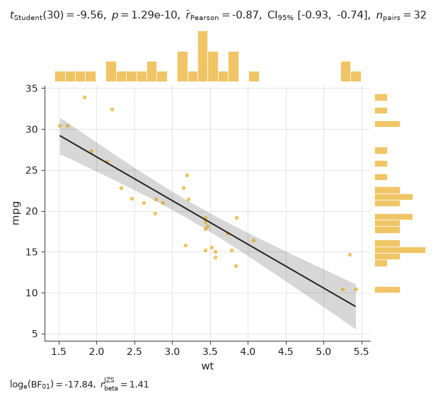

inferplot draws a statistical plot, runs the test that fits the design, and writes the full result on the figure: statistic, degrees of freedom, exact p-value, effect size with its confidence interval, Bayes factor, n and adjusted pairwise comparisons.

It is the Python counterpart of R's [ggstatsplot](https://github.com/IndrajeetPatil/ggstatsplot), tested against its output, and written for AI coding agents and the researchers who check their work.

Code: [github.com/sinkomr/inferplot](https://github.com/sinkomr/inferplot)

## What it does

- Five functions, one per question: do independent groups differ (`betweenstats`), do repeated measurements differ (`withinstats`), does one sample differ from a value (`histostats`), are two measurements related (`scatterstats`), and do the shares of categories differ (`barstats`).
- Parametric, nonparametric, robust and Bayesian versions of each test.
- The result is readable as text and JSON, not just from the image, so an agent (or a person) can check the numbers instead of squinting at a plot.
- Nothing is ignored silently: unknown arguments raise an error, and arguments that have no effect on the data leave a note.

Status: version 0.1, not on PyPI yet. Install it from the repository.

